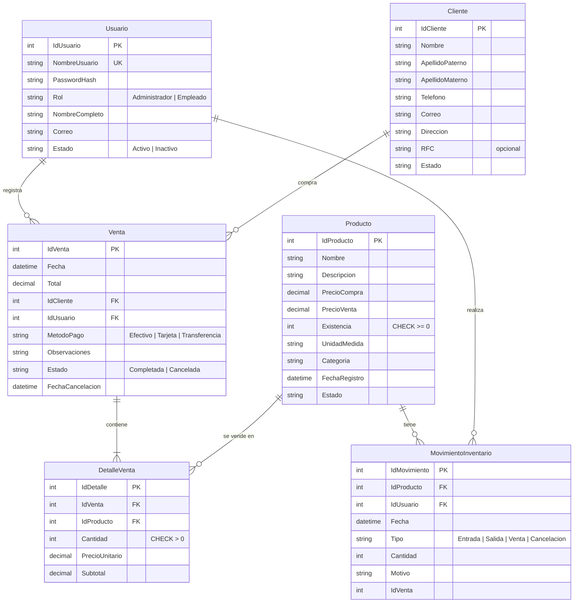
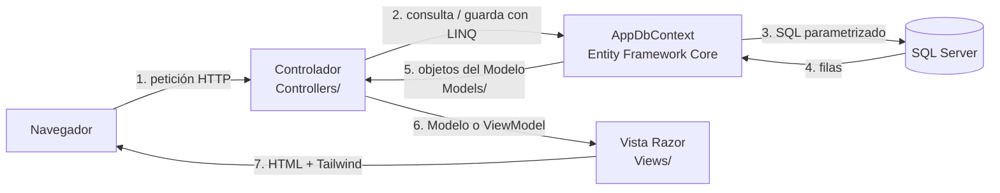
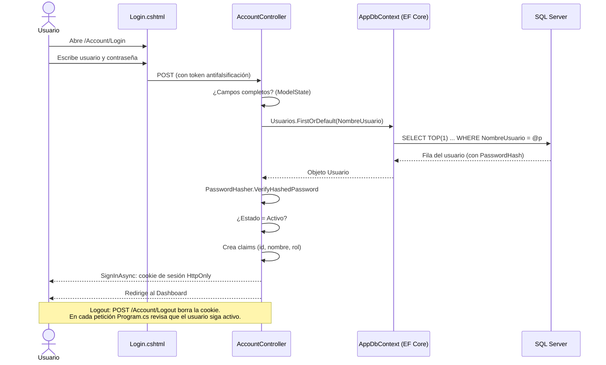
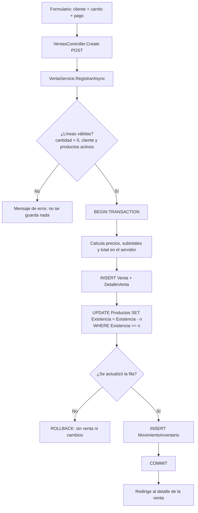

# Diagramas

Los diagramas usan Mermaid: se ven directamente en GitHub y en Visual Studio Code con la extensión Markdown Preview Mermaid.

## Modelo entidad-relación

Corresponde exactamente a las clases de `Models/` y a la migración `Inicial`. `MovimientoInventario` es la sexta tabla: guarda la trazabilidad de entradas, salidas, ventas y cancelaciones.

Reglas de borrado: `DetalleVenta` se elimina junto con su `Venta` (cascada); `Venta`→`Cliente`, `Venta`→`Usuario` y `DetalleVenta`→`Producto` son *Restrict*, por eso nada con historial se puede borrar (la aplicación lo desactiva).

## Arquitectura MVC

- **Modelo**: clases en `Models/` y `ViewModels/`; datos y reglas de validación.
- **Vista**: archivos `.cshtml`; solo presentan datos.
- **Controlador**: decide qué hacer con cada petición; las reglas de venta más delicadas están en `Services/VentaService.cs`.

## Flujo de autenticación

Archivos que participan: `Views/Account/Login.cshtml`, `ViewModels/LoginViewModel.cs`, `Controllers/AccountController.cs`, `Data/AppDbContext.cs`, `Models/Usuario.cs`, `Program.cs`.

## Registro de una venta

